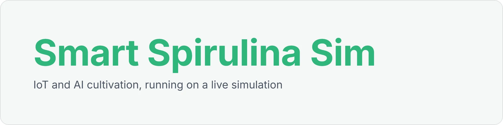
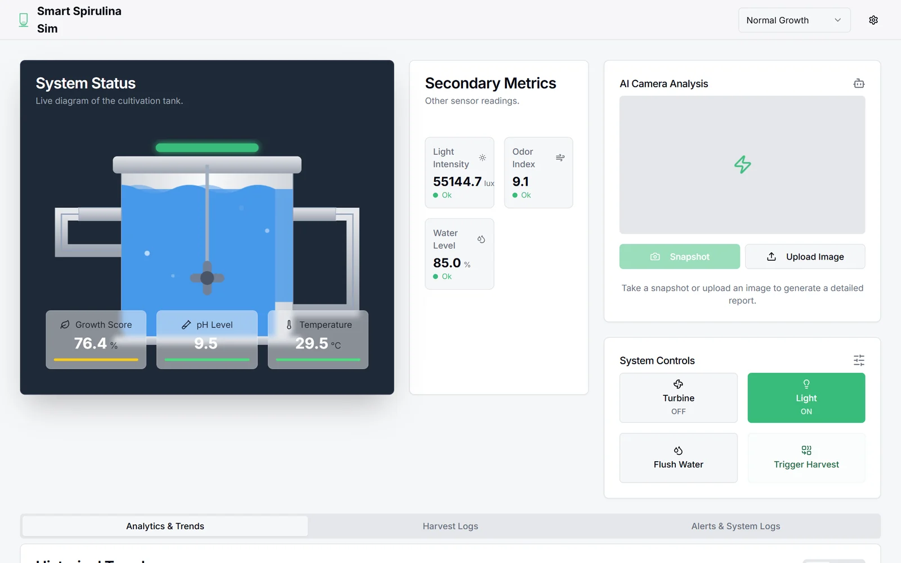
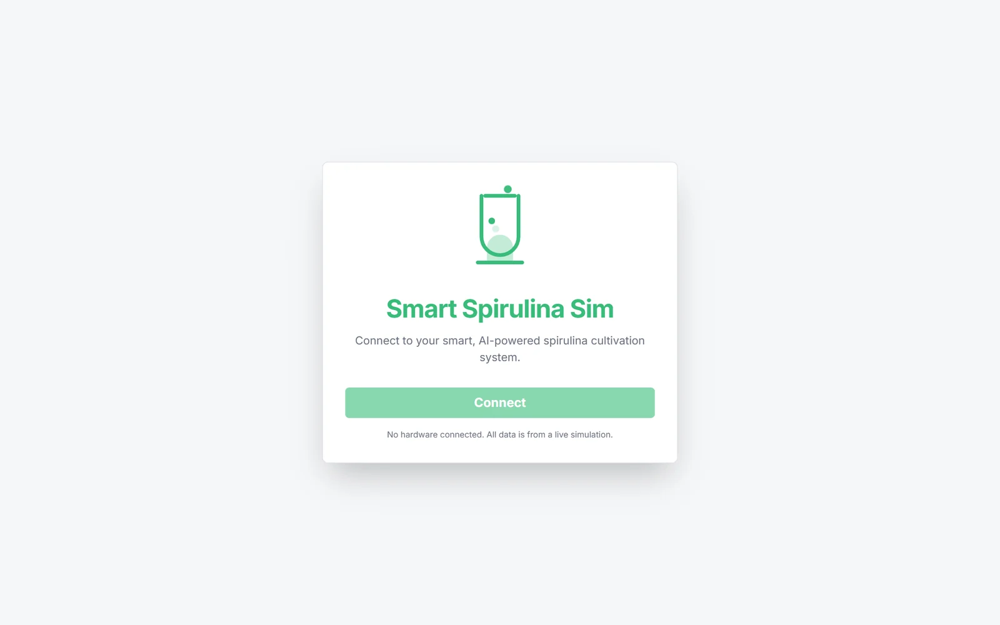
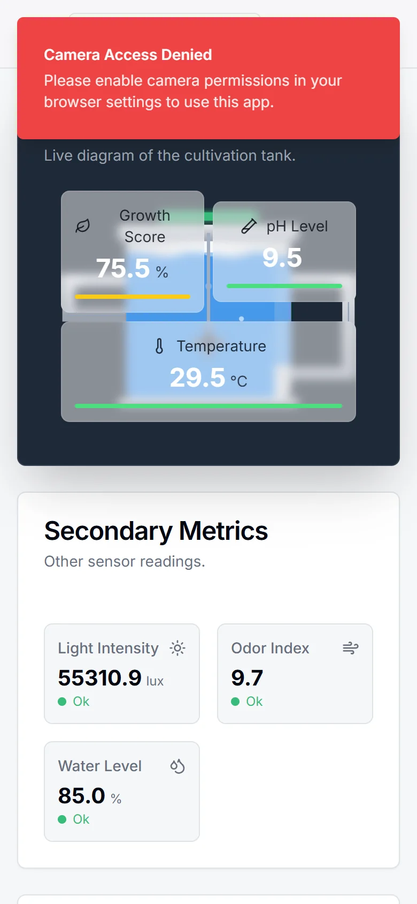

<div align="center">



**A working prototype of an IoT and AI spirulina cultivation system: live sensor values, a simulated AI camera, alerts and harvest logs, all running on simulated data.**

[Live demo](https://green-algae.vercel.app)



</div>

## What it does

Spirulina needs the right pH, temperature, light and water level, and goes bad fast when contaminated. This prototype behaves like a connected cultivation tank. No hardware is attached: a client-side simulation engine generates the readings.

- **System status**: a live diagram of the tank with growth score, pH and temperature.
- **Secondary metrics**: light intensity, odor index and water level, each with a recent-trend sparkline.
- **AI camera analysis**: take a snapshot or upload an image. A Genkit flow returns colour balance, biomass density, smell, contamination type, algae health, water clarity and a recommendation, each with a confidence score.
- **Controls**: turbine, light, flush/recycle water and trigger harvest.
- **Alerts and logs**: analytics and trends, harvest logs with exportable reports, and alert and system logs.

## Demo scenarios

Pick a scenario from the dropdown in the header and the whole dashboard reacts:

| Scenario | What happens |
|---|---|
| Normal Growth | The default, stable growth pattern |
| Contamination Event | Odor and turbidity spike, an alert fires and the AI panel flags the culture |
| Low-light Failure | The lighting fails and growth slows |
| Rapid Growth | Ideal conditions lead to an early "Harvest Ready" alert |

The settings panel (gear icon) changes the update frequency, growth rate, contamination probability and how often the AI check runs.

<table>
  <tr>
    <td width="60%"></td>
    <td width="40%" align="center"></td>
  </tr>
  <tr>
    <td><b>Connect.</b> The entry screen states that all data comes from a live simulation.</td>
    <td><b>Mobile.</b> The dashboard stacks into a single column.</td>
  </tr>
</table>

## Demo script

1. Press **Connect** to start the live simulation.
2. Walk through the live metrics and their sparklines, then the AI camera panel.
3. Switch to **Contamination Event**: odor and turbidity rise, an alert appears and the AI panel turns red.
4. Press **Flush / Recycle Water**: the water level dips and recovers, and the action appears in System Logs.
5. Switch to **Rapid Growth**, wait for "Harvest Ready", press **Trigger Harvest**, then export the report from Harvest Logs.

## Tech stack

Next.js, React, TypeScript, Tailwind CSS, shadcn/ui, Recharts, Genkit with Google AI.

## Run locally

```bash
npm install
npm run dev              # http://localhost:3000
```

The AI camera flow needs `GEMINI_API_KEY` in `.env`.
